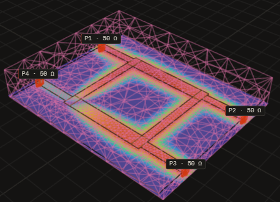
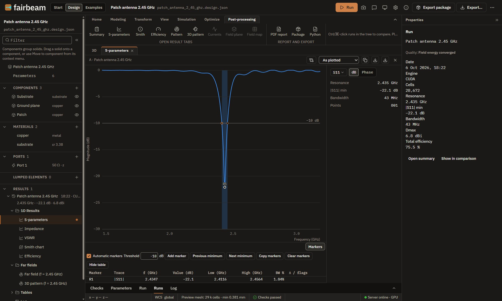

# Fairbeam

**The open electromagnetic workbench.** Design, simulate and document antennas and RF circuits on
the open-source [openEMS](https://openems.de) FDTD solver, from a ribbon-based 3D designer or from
parametric Python models.

[Website](https://fairbeam.org) · [Browser demo](https://fairbeam.org/app/) ·
[Getting started](docs/GETTING-STARTED.md) · [Documentation](docs/README.md)

This repository is the **[engineerman](https://github.com/engineerman) fork** of Fairbeam, with
opt-in experimental EMerge. It does not publish a separate desktop installer yet; build from source
below. Do not use the upstream Fairbeam updater or
[fairbeam-releases](https://github.com/ismailakdag/fairbeam-releases) binaries if you need the
EMerge path — those builds replace the engineerman fork.

## New features

### Experimental EMerge FEM

The engineerman fork adds an **opt-in** [EMerge](https://github.com/FennisRobert/EMerge)
frequency-domain FEM backend beside the default openEMS FDTD path. openEMS stays the production
solver; EMerge is experimental research only (`results_exported`, never a validated production
certificate).

- **Install EMerge** from Simulation → Experimental solvers (Windows managed venv, pinned
  `emerge==3.0.0b12`; optional path / `FAIRBEAM_EMERGE_PYTHON` elsewhere).
- **Session engine picker:** choose **EMerge (experimental)** to retarget Run chrome, Frequency /
  Boundaries / Mesh settings and which Simulation actions stay enabled.
- **One Run entry — EMerge FEM · Experimental:** driven/lumped or planar microstrip Designs with
  **1–8 ports of one type**, full experimental N×N S-matrix (`fairbeam.emerge-result/2`).
- **Mesh without solve**, FEM surface overlay in Mesh view, mid-plane E-field cuts, and a Design
  port→boundary-condition preview with explicit `accept_*` gates (no silent geometry remap).
- Fixed WR-90 waveguide fixture remains available for analytic checks.

Details: [experimental solvers](docs/EXPERIMENTAL-SOLVERS.md) ·
[EMerge experiment](docs/EMERGE-EXPERIMENT.md).



## Download

**engineerman fork:** no fork-specific desktop release yet. Use [From source](#from-source) (or a
local desktop build you produce yourself). Automatic updates against upstream
`fairbeam-releases` are **disabled** in this tree so an upstream install cannot wipe the EMerge
integration.

**Upstream Fairbeam** (openEMS only, without the engineerman fork’s EMerge path): the desktop app is free for
**macOS** (Apple silicon, signed with a Developer ID and notarized by Apple) and **Windows** x64
from [fairbeam-releases](https://github.com/ismailakdag/fairbeam-releases/releases/latest). That
app installs its own runtime on first start. The Windows installer is not code-signed; SmartScreen
may show "Windows protected your PC": choose **More info › Run anyway**. The
[browser demo](https://fairbeam.org/app/) opens the example projects read-only, without installing
anything. [Getting started](docs/GETTING-STARTED.md) covers the upstream install path.

## What it does



- **Designer.** Draw parametric solids and sheets, use Boolean operations, transforms and a working
  coordinate system, add ports and lumped elements, check the model, mesh it and run it, in one
  window ([designer guide](docs/DESIGNER.md)).
- **Simulation.** openEMS on the CPU, or the optional GPU engine (Metal on Apple silicon, CUDA on
  NVIDIA cards). Automatic meshing, mesh convergence, parameter sweeps and a goal-driven optimizer
  ([meshing](docs/MESHING.md), [run server](docs/RUN-SERVER.md), [optimizer](docs/OPTIMIZE.md),
  [GPU engine](docs/GPU.md)).
- **Results.** S-parameters with markers, impedance, VSWR, Smith and polar charts, 2D and 3D
  far-field patterns (directivity, gain, realized gain, efficiency), surface currents and field
  planes, multi-port S-matrices and arrays with beam steering. Supported result plots provide data tables and run
  comparisons ([results](docs/RESULTS.md), [multi-port](docs/MULTIPORT.md),
  [arrays](docs/ARRAYS.md)).
- **Python models and CLI.** One Python file per antenna or circuit, with templates; the `fairbeam`
  CLI runs, sweeps, converges and optimizes them ([writing models](docs/MODELS.md),
  [CLI](docs/CLI.md)).
- **Outputs.** B&W technical drawings, publication figures, a PDF report and an export package;
  Touchstone and CSV; STL, glTF and Blender scenes, with optional rendered images; fabrication files
  (Gerber X2, Excellon, DXF; preview) ([exports](docs/EXPORTS.md)).
- **File compatibility.** CST-compatible VBA macro export (`.bas`) and macro import (`.bas`,
  `.mcs`, `.txt`) ([designer guide](docs/DESIGNER.md#importing-a-vba-macro)).

## Open and reproducible

Fairbeam supports reproducible workflows through recorded inputs, versioned bundles and documented export formats:
- **Findable** results: versioned, self-describing project bundles that record the generator, the
  versions and the run settings (`fairbeam.project/1`).
- **Accessible:** open formats and no licence server.
- **Interoperable:** Touchstone, CSV, STL, glTF, Gerber/Excellon and VBA macros.
- **Reusable:** GPL-3.0-or-later project models with recorded inputs; third-party models retain their own terms.

Results are checked against analytical references ([validation](docs/VALIDATION.md),
[how results are computed](docs/RESULTS.md)).

## Status

Fairbeam is in active development (0.x releases). The current desktop release is available from
the [downloads page](https://fairbeam.org/#download). The Python pipeline, the designer and the desktop app work
end to end on macOS (Apple silicon) and on Windows 11. The project file format is versioned, and
breaking changes bump its version. The fabrication outputs
have not yet been checked by a fab. Known gaps and plans are in
[the roadmap](https://fairbeam.org/roadmap.html#roadmap), which distinguishes released work, changes awaiting a release and planned features.

## Use and limitations

Fairbeam is shared to support education, research and open-source collaboration, without warranties.
Results may contain errors and should be independently verified through mesh-convergence checks
and suitable analytical references or measurements. To the extent permitted by applicable law,
the authors and contributors accept no liability for losses arising from its use; see
[LICENSE](LICENSE), sections 15–17. This statement does not restrict uses permitted by the license,
including commercial use. See [Validation](docs/VALIDATION.md) for tested cases and their limits.

## Privacy

Since Fairbeam 0.7.2, the desktop app asks once whether you want to help count installs. Counting
is off until you choose **Allow**; **No thanks** or dismissing the dialog keeps it off. Sign-in
remains disabled. With consent, the app sends a random install ID, app version, operating system,
CPU architecture and report schema to `fairbeam.org/api/ping`, at most once every seven days.
Designs, files and simulation results are not included. You can turn counting off at any time in
**Settings > General > Install counts**, which deletes the local install ID and stops future
install-count requests. `FAIRBEAM_NO_TELEMETRY=1` also disables counting for that process.

Update checks contact GitHub (fairbeam-releases); app and runtime downloads come from GitHub and
upstream hosts. The website and install-count API are hosted on Vercel. Hosting providers see your
IP address and request data; their own policies govern infrastructure logs. See the
[privacy notice](https://fairbeam.org/privacy.html) for the controller, purpose, processors,
retention, rights and international processing details. For privacy questions or rights requests,
contact ismail@fairbeam.org. Do not post personal information in public issues.

## From source

Requirements: Python 3.10+, Node.js 22.12.0+ and an openEMS build. On macOS (and Linux) a script builds
openEMS for you:

```bash
scripts/install-openems-macos.sh                              # openEMS + CSXCAD into ~/opt/openEMS
~/opt/openEMS/venv/bin/fairbeam run python/models/patch_antenna.py
npm install
npm run serve &   # the run server on port 5320 (Run panel, sweeps, optimizer)
npm run dev       # the viewer and designer on http://127.0.0.1:5310
```

- Windows: [docs/WINDOWS.md](docs/WINDOWS.md).
- The desktop app: [docs/DESKTOP.md](docs/DESKTOP.md).
- Everything else, including the test suite: [docs/FROM-SOURCE.md](docs/FROM-SOURCE.md).

## Contributing and feedback

- Found a problem or missing something? Use **Help › Report a problem** in the app, or open an
  issue at [fairbeam-releases](https://github.com/ismailakdag/fairbeam-releases/issues). The app
  fills in the version and the operating system.
- Code and documentation contributions are welcome as pull requests here. Read
  [CONTRIBUTING.md](CONTRIBUTING.md) first.
- Fairbeam is developed with AI coding assistance. How that works, and the rules for AI-assisted
  contributions, are in the [AI policy](AI_POLICY.md).

## Citing Fairbeam

If Fairbeam contributes to published work, please cite it. The **Cite this repository** button on
GitHub gives APA and BibTeX entries from [CITATION.cff](CITATION.cff). Source releases are archived
on [Zenodo](https://zenodo.org), which gives each version a DOI; cite the version you used. Please
also cite [openEMS](https://openems.de), which computes the fields.

## Credits

- **Maintainer:** [İsmail Akdağ](https://akdag.dev).
- **Contributors:** [Cem Göçen](https://github.com/cgroceny):
  - the material cell (NRW/NIST extraction);
  - dispersive materials (Debye, Lorentz, Drude, Djordjevic-Sarkar);
  - waveguide, coaxial, stripline and surface-wave reference fixtures;
  - two-line calibration, ideal network and L/C references;
  - grouped discrete ports and multiport convergence criteria.
- **Solvers:** Fairbeam runs [openEMS](https://openems.de) and [CSXCAD](https://github.com/thliebig/CSXCAD)
  by Thorsten Liebig and contributors. The optional GPU engine is
  [SeanMollet/openEMS](https://github.com/SeanMollet/openEMS). An opt-in experimental FEM path uses
  [EMerge](https://github.com/FennisRobert/EMerge) by Robert Fennis (managed Install EMerge; not
  bundled in the default installer).
- **Libraries:** the viewer uses [SolidJS](https://www.solidjs.com) and
  [three.js](https://threejs.org), and the desktop shell is built with [Tauri](https://tauri.app).
- **Details:** selected third-party components and source locations are listed in [NOTICE.md](NOTICE.md).

## License

Fairbeam is free software under the GNU General Public License, version 3 or later
([LICENSE](LICENSE)). openEMS is GPL-3.0-or-later; CSXCAD and fparser are LGPL-3.0-or-later. Project
bundles are plain data produced by your own models. Third-party notices are in
[NOTICE.md](NOTICE.md).
