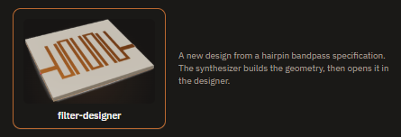
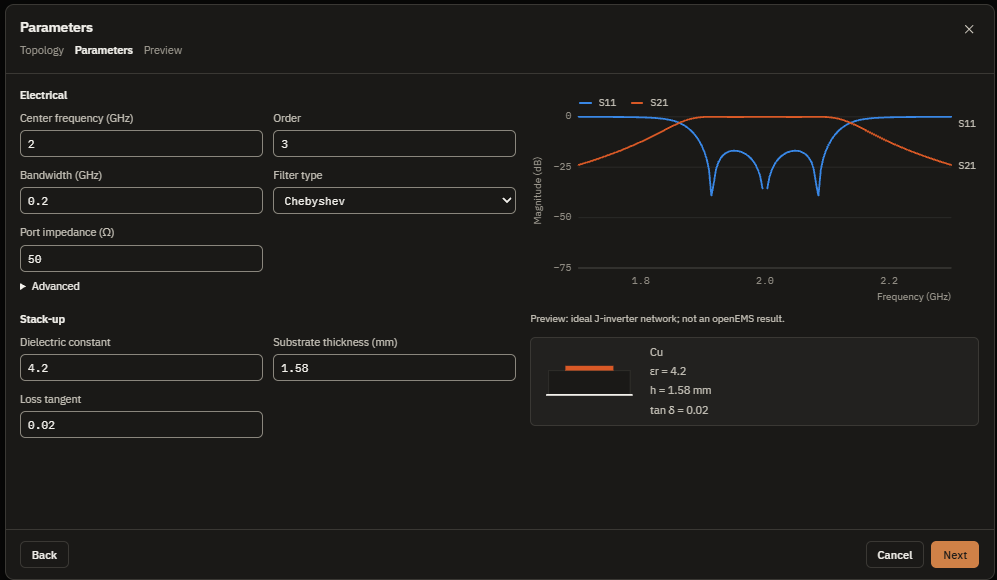

# Filter designer (hairpin bandpass)

Fairbeam’s **Filter designer** synthesizes a planar **hairpin microstrip bandpass** from
electrical and stack-up inputs, then opens the layout as a new Design in the ribbon designer.
It is a synthesis wizard, not a full-filter electromagnetic solve: the live S-parameter plot is
an ideal network preview, and Finish hands geometry to the designer so you can run openEMS (or
another backend) and tune with Sweep / Optimizer afterward.

## Open the wizard

From the **Start** screen, use the **filter-designer** product tile (label `filter-designer`).
The note under the tile describes the flow: specify a hairpin bandpass, synthesize geometry, then
open it as a new design.

## Wizard steps

The modal walks three steps: **Topology → Parameters → Preview**.

### Topology

Choose a microstrip hairpin card:

- **Hairpin bandpass** — square outer fold corners (`hairpin_microstrip_bp`)
- **Hairpin bandpass (mitered)** — Douville–James miters on the U outer folds
  (`hairpin_microstrip_bp_mitered`), same electrical / stack synthesizer

Selecting a card advances to Parameters. Other planar filter families are not offered yet.

### Parameters

Edit the electrical and stack-up form on the left. Typical fields:

- **Order**, center frequency, bandwidth, filter type (Chebyshev, Butterworth, equiripple),
  port impedance, and (when applicable) passband ripple
- **Stack-up:** dielectric constant, substrate thickness, loss tangent
- Layout helpers such as feed length and board margin (intra-resonator gap is fixed by the
  synthesizer seed, then becomes Optimizer-tunable gaps on the committed design)

On the right, a **live theoretical** `|S11|` / `|S21|` plot updates as the form stays valid. The
caption states that this is a preview of the **ideal J-inverter network**, **not an openEMS
result**. Beside the stack fields, a schematic **microstrip stack-up** cross-section shows the
current εr, thickness, and loss tangent.

**Next** runs closed-form synthesis for the seed layout and moves to Preview when checks pass.
Invalid inputs or synthesizer errors stay on Parameters with a message.

### Preview (geometry and commit)

Preview shows the seed geometry in millimeters, the same ideal S preview, and a geometry
parameter table. Choose how dimensions are finalized:

| Method | What it does |
| --- | --- |
| **Closed form** | Millimeters come from the formulas immediately; no electromagnetic solve runs. |
| **EDC** (EM design curves) | Small electromagnetic sweeps build external Q (`Qe`) and coupling (`k`) curves; choose EDC, then **Start EDC**. Progress and Cancel are shown while the study runs. Geometry and table rows refresh when the study finishes. |

**Finish** commits the layout only after Closed form is selected, or after EDC status is done.
The new Design opens in the designer. The UI states that the next step is optimization (and your
own EM run). The wizard does **not** run the Optimizer or a full-filter openEMS solve for a
measured final S-parameter certificate.

## Ideal S versus real EM

Keep these boundaries clear:

- The Parameters and Preview S plots are **theoretical** (ideal J-inverter / coupled-line
  network). They are teaching and synthesis feedback, not solver output.
- **Closed form** never starts an EM solve inside the wizard.
- **EDC** runs bounded resonator / coupling studies to refine seed dimensions; it still does
  **not** replace a full-filter openEMS (or experimental FEM) run on the finished Design.
- After Finish, use the normal Simulation path for real S-parameters, and Optimize / Sweep for
  tuning independent layout parameters on the committed file.

## Related

- [The designer](DESIGNER.md) — workspace after Finish
- [Optimizer](OPTIMIZE.md) — tuning the committed Design
- [Experimental solvers](EXPERIMENTAL-SOLVERS.md) — optional EMerge / Elmer backends on a Design
  (separate from Filter designer synthesis)
