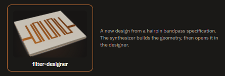
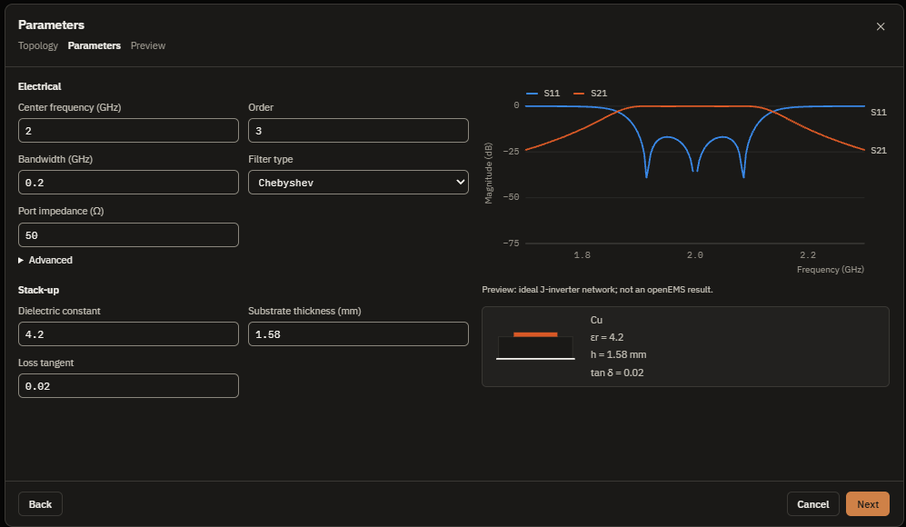

# Filtre tasarımcısı (saç tokası bant geçiren)

Fairbeam **Filtre tasarımcısı**, elektrik ve yığın girdilerinden düzlemsel bir **saç tokası
mikroşerit bant geçiren** filtre sentezler ve yerleşimi şerit tasarımcıda yeni bir Tasarım olarak
açar. Tam filtre elektromanyetik çözümü değil, bir sentez sihirbazıdır: canlı S-parametre grafiği
ideal bir ağ önizlemesidir; Tamamla geometriyi tasarımcıya verir, böylece ardından openEMS (veya
başka bir arka uç) çalıştırabilir ve Tarama / Optimizatör ile ince ayar yapabilirsiniz.

## Sihirbazı açma

**Başlangıç** ekranından **filter-designer** ürün karosunu kullanın (etiket `filter-designer`).
Karo altındaki not akışı açıklar: saç tokası bant geçireni belirtin, geometriyi sentezleyin, sonra
yeni tasarım olarak açın.

## Sihirbaz adımları

Modal üç adım izler: **Topoloji → Parametreler → Önizleme**.

### Topoloji

**Saç tokası bant geçiren** (microstrip) seçin. Bu sürümde sunulan topoloji kartı budur; diğer
düzlemsel filtre kartları henüz yoktur. Kartı seçmek Parametreler’e ilerletir.

### Parametreler

Solda elektrik ve yığın formunu düzenleyin. Tipik alanlar:

- **Derece**, merkez frekansı, bant genişliği, filtre tipi (Çebişev, Butterworth, equiripple),
  port empedansı ve (uygunsa) geçirme bandı dalgalanması
- **Yığın:** dielektrik sabiti, alttaş kalınlığı, kayıp tanjantı
- Besleme uzunluğu ve kart payı gibi yerleşim yardımcıları (rezonatör içi boşluk sentezleyici
  tohumunda sabittir; kaydedilen tasarımda Optimizatör ile ayarlanabilir boşluklara dönüşür)

Sağda, form geçerliyken **canlı teorik** `|S11|` / `|S21|` grafiği güncellenir. Altyazı bunun
**ideal J-inverter ağının** bir önizlemesi olduğunu ve **openEMS sonucu olmadığını** belirtir.
Yığın alanlarının yanında şematik bir **mikroşerit yığın** kesiti güncel εr, kalınlık ve kayıp
tanjantını gösterir.

**İleri**, tohum yerleşimi için kapalı form sentezini çalıştırır; denetimler geçerse Önizleme’ye
geçer. Geçersiz girdiler veya sentezleyici hataları Parametreler’de mesajla kalır.

### Önizleme (geometri ve kaydetme)

Önizleme, tohum geometrisini milimetre ölçeğinde, aynı ideal S önizlemesini ve bir geometri
parametre tablosunu gösterir. Boyutların nasıl kesinleşeceğini seçin:

| Yöntem | Ne yapar |
| --- | --- |
| **Kapalı form** | Milimetreler formülden hemen gelir; elektromanyetik çözüm çalışmaz. |
| **EDC** (EM tasarım eğrileri) | Küçük elektromanyetik taramalar dış Q (`Qe`) ve bağlaşım (`k`) eğrilerini üretir; EDC’yi seçin, sonra **EDC’yi başlat**’a basın. Çalışma sürerken ilerleme ve İptal gösterilir. Çalışma bitince geometri ve tablo satırları yenilenir. |

**Tamamla**, yalnızca Kapalı form seçildikten sonra veya EDC durumu tamamlandıktan sonra yerleşimi
kaydeder. Yeni Tasarım tasarımcıda açılır. Arayüz sonraki adımın optimizasyon (ve kendi EM
çalıştırmanız) olduğunu belirtir. Sihirbaz, ölçülmüş nihai bir S-parametre belgesi için
Optimizatörü veya tam filtre openEMS çözümünü **çalıştırmaz**.

## Ideal S ile gerçek EM

Bu sınırları net tutun:

- Parametreler ve Önizleme S grafikleri **teoriktir** (ideal J-inverter / bağlaşık hat ağı).
  Öğretici ve sentez geri bildirimidir; çözücü çıktısı değildir.
- **Kapalı form** sihirbaz içinde EM çözümü başlatmaz.
- **EDC**, tohum boyutlarını iyileştirmek için sınırlı rezonatör / bağlaşım çalışmaları çalıştırır;
  bitmiş Tasarım üzerinde tam filtre openEMS (veya deneysel FEM) çalıştırmasının yerini **almaz**.
- Tamamla’dan sonra gerçek S-parametreleri için normal Simülasyon yolunu, kaydedilen dosyadaki
  bağımsız yerleşim parametrelerini ayarlamak için Optimize / Tarama’yı kullanın.

## İlgili

- [Tasarımcı](DESIGNER.md) — Tamamla sonrası çalışma alanı
- [Optimizatör](OPTIMIZE.md) — kaydedilen Tasarımı ince ayar
- [Deneysel çözücüler](EXPERIMENTAL-SOLVERS.md) — Tasarım üzerinde isteğe bağlı EMerge / Elmer
  arka uçları (Filtre tasarımcısı sentezinden ayrıdır)
