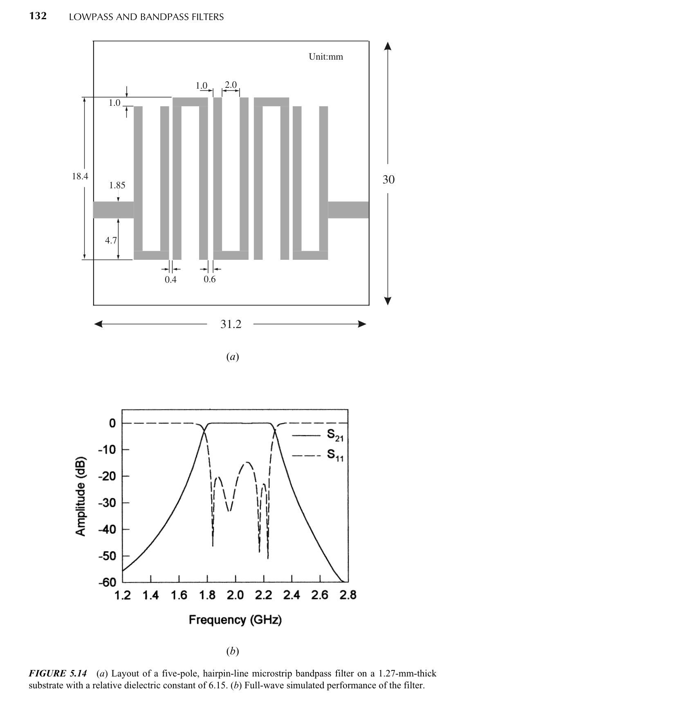
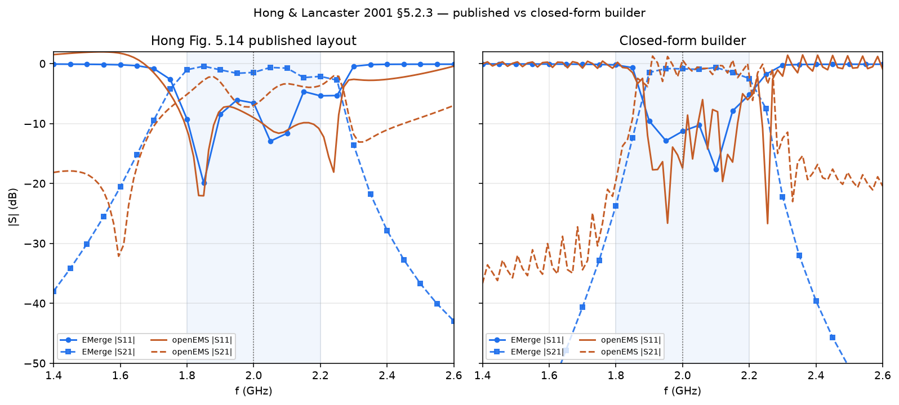

# Published hairpin geometry check

Read-only. The closed-form builder is `synthesize_hairpin_microstrip_bp`. Nothing here changes that function.

The case is Hong and Lancaster, *Microstrip Filters for RF/Microwave Applications* (Wiley, 2001), section 5.2.3 and Figure 5.14: five hairpins, 2 GHz, 20% bandwidth, 0.1 dB Chebyshev, εr = 6.15, h = 1.27 mm.

Run the millimeter table:

```text
python -m fairbeam.filter_synthesis.hairpin.verification.hong_2001
```

from `python/`, or `python -m unittest tests.test_hairpin_published_geometry`.

Dual-solver S (EMerge + openEMS) for the **published** Fig. 5.14 millimeters and for the **builder** geometry:

```text
python -m fairbeam.filter_synthesis.hairpin.verification.dual_solve all
```

Or step by step: `build`, then `emerge published|builder`, `openems published|builder`, `plot`. Raw files (gitignored): `.sim/hairpin-hong-2001-verification/`. Plot copied next to this README as `compare_s.png`.

## Figure 5.14 comparison

Source: Jia-Sheng Hong and M. J. Lancaster, *Microstrip Filters for RF/Microwave Applications*, Wiley, 2001, §5.2.3 and Figure 5.14. The synthesis code was not modified. This record only calls `synthesize_hairpin_microstrip_bp`.

Inputs given to the closed-form builder:

| Input | Value |
| --- | --- |
| Center frequency | 2 GHz |
| Bandwidth | 0.4 GHz (fractional bandwidth 0.2) |
| Order | 5 |
| Response | Chebyshev, 0.1 dB ripple |
| Port impedance | 50 Ω |
| Relative permittivity | 6.15 |
| Substrate thickness | 1.27 mm |
| U arm gap | 2.0 mm (passed in; the builder does not compute it) |

The book’s resonator is a 1.0 mm, 68.3 Ω arm. Figure 5.14 draws the input arm at 18.4 mm after shortening. Equation (5.26) printed in the text is t = 6.03 mm at L = 20.4 mm and Zr = 68.3 Ω. The 7.625 mm tap and the 0.40 / 0.60 mm gaps are the full-wave layout, not closed-form results.

| Parameter | Book | Builder | Difference | Difference |
| --- | ---: | ---: | ---: | ---: |
| Quarter-wave length vs text L | 20.40 mm | 17.81 mm | −2.59 mm | −12.7% |
| Quarter-wave length vs drawn arm | 18.40 mm | 17.81 mm | −0.59 mm | −3.2% |
| Resonator width | 1.00 mm | 1.87 mm | +0.87 mm | +87% |
| Feed width | 1.85 mm | 1.87 mm | +0.02 mm | +1.3% |
| Tap offset vs equation (5.26) | 6.03 mm | 6.25 mm | +0.22 mm | +3.6% |
| Tap offset vs EM layout | 7.63 mm | 6.25 mm | −1.38 mm | −18% |
| Outer coupling gap | 0.40 mm | 0.65 mm | +0.25 mm | +64% |
| Inner coupling gap | 0.60 mm | 0.79 mm | +0.19 mm | +32% |
| U arm gap | 2.00 mm | 2.00 mm | 0 mm | 0% |

The layout does not match Figure 5.14. The feed width is close. The U gap matches only because 2.0 mm was an input. The builder makes every arm a 50 Ω line, so width, length, tap, and even/odd gaps all move relative to the book’s 68.3 Ω arm and its EM gaps. Given the book’s own L, Zr, and Qe, the same tap helper returns 6.030 mm, and a 68.3 Ω line on this substrate is 1.000 mm wide. Those two checks are not what the hairpin layout requests.

## Book figure (Hong Fig. 5.14)

Cropped from Hong & Lancaster 2001, p. 132 (PDF page 154): layout (a) and the book’s own full-wave S (b). Source PDF is kept locally (gitignored). Fair use for verification against our dual-solver plot below — not a claim that our “published” recreate matches this artwork.



Figure 5.14(b) is a clean ~2 GHz bandpass with deep in-band |S11| notches. Compare that to our dual-solver “published” panel: the book response is the target reference; our left panel is only Fairbeam’s approximate millimeters on the alternating-U sketch.

## Dual-solver S (this machine, 2026-11-11)

Same stack on both layouts: εr = 6.15, h = 1.27 mm, tan δ = 0.0027, feed length 8 mm, board margin 6 mm. Coarse EMerge with lumped terminals (`results_exported`). openEMS GPU, 250000 steps per port, `converged` false. Numbers rounded to 0.01 dB from `emerge_s_summary.json` and `openems_direct/openems_s_summary.json`. Not `results_validated`.

### Geometries that were solved

Published layout forces the Fig. 5.14 EM millimeters onto the Fairbeam hairpin Design JSON. One shared `q_len` = drawn arm 18.4 mm (the book shortens I/O relative to text L = 20.4 mm; middle resonators are not given separate lengths here). Spacings are outer / inner / inner / outer = 0.40 / 0.60 / 0.60 / 0.40 mm. Tap = 7.625 mm. Resonator width = 1.00 mm. Feed width = 1.85 mm.

Builder layout is the unmodified `synthesize_hairpin_microstrip_bp` output for the table inputs above (50 Ω arms, closed-form gaps and tap).

| Key | Published (solved) | Builder (solved) |
| --- | ---: | ---: |
| q_len | 18.40 mm | 17.81 mm |
| w0…w4 | 1.00 mm | 1.87 mm |
| w_feed | 1.85 mm | 1.87 mm |
| tap_from_fold | 7.625 mm | 6.245 mm |
| sp0 / sp3 | 0.40 mm | 0.654 mm |
| sp1 / sp2 | 0.60 mm | 0.792 mm |
| gap0…gap4 | 2.00 mm | 2.00 mm |

### Measured S

| Layout | Solver | S11 at 2.00 GHz | S21 at 2.00 GHz | S11 at 1.80 GHz | S21 at 1.80 GHz | S11 at 2.20 GHz | S21 at 2.20 GHz |
| --- | --- | ---: | ---: | ---: | ---: | ---: | ---: |
| Published | EMerge | −6.57 dB | −1.47 dB | −9.27 dB | −1.02 dB | −5.37 dB | −2.13 dB |
| Published | openEMS | −9.02 dB | −6.98 dB | −11.91 dB | −4.91 dB | −10.79 dB | −3.75 dB |
| Builder | EMerge | −11.30 dB | −0.88 dB | −0.22 dB | −23.73 dB | −5.18 dB | −2.48 dB |
| Builder | openEMS | −17.45 dB | +0.61 dB | +0.21 dB | −18.17 dB | −6.03 dB | −0.02 dB |

openEMS frequencies for the 1.80 / 2.20 GHz columns are the nearest samples (1.805 GHz and 2.195 GHz).

### Run facts

| Layout | EMerge | openEMS |
| --- | --- | --- |
| Published | `results_exported`, 134.3 s, 8995 nodes, 50637 tetrahedra, 25 points from 1.40 to 2.60 GHz | 1 204 352 FDTD cells (194 × 97 × 64), 250000 steps each port, energy about −11.8 / −11.0 dB, wall 145.7 s, engine `gpu` |
| Builder | `results_exported`, 158.3 s, 11199 nodes, 63364 tetrahedra, 25 points from 1.40 to 2.60 GHz | 856 900 FDTD cells (164 × 95 × 55), 250000 steps each port, energy about −19.0 / −19.5 dB, wall 108.5 s, engine `gpu` |

### Reading

On EMerge, the builder passband at 2.00 GHz is deeper in transmission (S21 −0.88 dB) than the published-millimeter layout (S21 −1.47 dB), and the builder stopband at 1.80 GHz is much stronger (−23.73 dB vs −1.02 dB). That does not mean the book filter is wrong: the published solve uses a single 18.4 mm arm length for all five U’s and the book’s EM gaps on Fairbeam’s alternating-U sketch, not a digitization of Figure 5.14’s artwork.

openEMS on the published layout was still energetic when the step cap hit (about −11 dB), so those |S| numbers are coarse. On the builder layout openEMS again shows |S| slightly above 0 dB (S21 +0.61 dB at 2.00 GHz), same class of artifact as the other hairpin dual-solver notes. These notes do not claim the solvers agree, and they do not mark either run `results_validated`.

### Plot


